# Lạc Việt Data — Hệ thống dữ liệu & AI cho doanh nghiệp Việt

**Lạc Việt Data** (Hệ thống Dữ liệu Lạc Việt) là bản demo một nền tảng dữ liệu đám mây kèm AI, làm hoàn toàn bằng tiếng Việt. Doanh nghiệp đưa dữ liệu về một nơi, rồi:

- Viết SQL và **chạy thật ngay trên trình duyệt**, kết quả có thống kê từng cột, biểu đồ, xuất CSV
- **Hỏi dữ liệu bằng tiếng Việt**: trợ lý **Tinh Ý** tự viết SQL, chạy, vẽ biểu đồ và viết nhận định
- Dùng **hàm AI ngay trong SQL** để đọc cảm xúc, phân loại chủ đề đánh giá khách hàng tiếng Việt
- Dựng **tác tử AI**, **ứng dụng dữ liệu**, nhận dữ liệu từ **chợ dữ liệu**
- Giám sát truy vấn, kho tính toán, chi phí, người dùng, bảo mật

> ⚠️ Đây là **sản phẩm demo giao diện** do [Ntahien Tech](https://ntahientech.com) thiết kế và lập trình. Lạc Việt Data, chuỗi cà phê **Phố Núi** và các nhà cung cấp đám mây (Trường Sơn, Âu Cơ, Hồng Bàng) đều là **tên hư cấu**, không liên quan tới doanh nghiệp nào trùng tên. Toàn bộ dữ liệu là **dữ liệu mô phỏng**.

🔗 **Demo:** https://hethonglacviet.vercel.app — bấm **"Vào bằng tài khoản demo"** ở trang đăng nhập (hoặc mở thẳng [/trang-chu?demo=1](https://hethonglacviet.vercel.app/trang-chu?demo=1)).

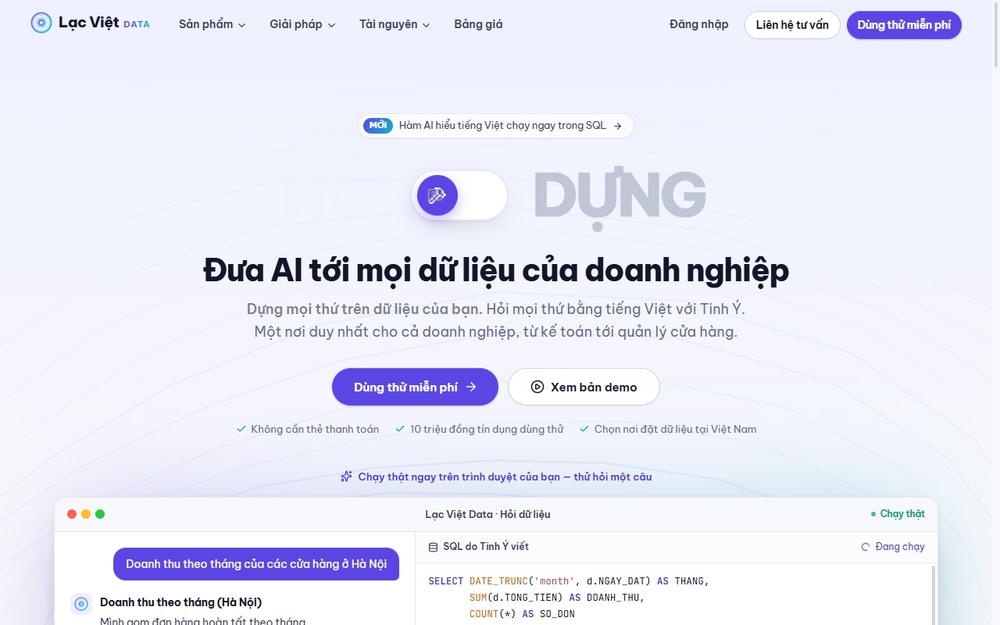

## Điểm khác biệt: SQL chạy thật, không cần máy chủ

Ứng dụng nhúng **SQLite bản WebAssembly** (sql.js). Khi trang mở, trình duyệt tự sinh bộ dữ liệu mẫu của chuỗi cà phê Phố Núi rồi nạp vào cơ sở dữ liệu ngay trên máy người xem. Bộ dữ liệu gồm 20 cửa hàng trên 14 tỉnh, thành (theo 34 tỉnh, thành mới), khoảng 14.000 đơn hàng năm 2026, 900 khách hàng thành viên và 240 đánh giá tiếng Việt. Bước nạp mất khoảng 0,3 giây.

- Mọi câu lệnh bạn gõ đều được thực thi thật: lọc, gom nhóm, nối bảng, hàm cửa sổ, CTE, tạo bảng, chèn dòng…
- Hiểu thêm cú pháp quen thuộc của kho dữ liệu đám mây: `USE`, `CREATE OR REPLACE`, `SHOW TABLES`, `DESCRIBE`, tên đầy đủ `PHO_NUI_DB.BAN_HANG.DON_HANG`, `DATEADD`, `DATEDIFF`, `DATE_TRUNC`, `ILIKE`, ép kiểu `::`. Thông báo lỗi được dịch sang tiếng Việt.
- **Hàm AI tiếng Việt** dùng được trong SQL: `AI_CAM_XUC`, `AI_DIEM_CAM_XUC`, `AI_PHAN_LOAI`, `AI_TOM_TAT`, `AI_TRICH_XUAT`, `AI_DICH`, cùng `KHONG_DAU`, `DINH_DANG_VND`, `THU_TRONG_TUAN`.
- Tải tệp CSV lên sẽ tạo bảng thật. Bảng, tệp SQL và các thay đổi khác được lưu trong trình duyệt (`localStorage`), tải lại trang vẫn còn.

```sql
SELECT c.TEN_CUA_HANG,
       AI_CAM_XUC(g.NOI_DUNG) AS CAM_XUC,
       AI_PHAN_LOAI(g.NOI_DUNG, 'Đồ uống, Phục vụ, Không gian, Giao hàng') AS CHU_DE
FROM PHO_NUI_DB.MARKETING.DANH_GIA g
JOIN PHO_NUI_DB.BAN_HANG.CUA_HANG c ON c.MA_CH = g.MA_CH
WHERE AI_CAM_XUC(g.NOI_DUNG) = 'Tiêu cực';
```

**Về phần AI:** Tinh Ý và các hàm AI là **mô phỏng chạy cục bộ**, không gọi mô hình ngôn ngữ bên ngoài. Tinh Ý nhận diện ý định và bộ lọc trong câu hỏi bằng quy tắc (tỉnh thành, vùng miền, tháng, quý, "30 ngày qua", top N, kênh bán…) rồi sinh SQL. Nó trả lời tốt khoảng 20 dạng câu hỏi về doanh thu, món bán chạy, cửa hàng, khách hàng, đánh giá, khuyến mãi, lãi gộp. Các hàm AI dùng từ điển tiếng Việt.

## Ảnh giao diện

| Không gian làm việc (SQL + hàm AI) | Hỏi dữ liệu bằng tiếng Việt |
|---|---|
| 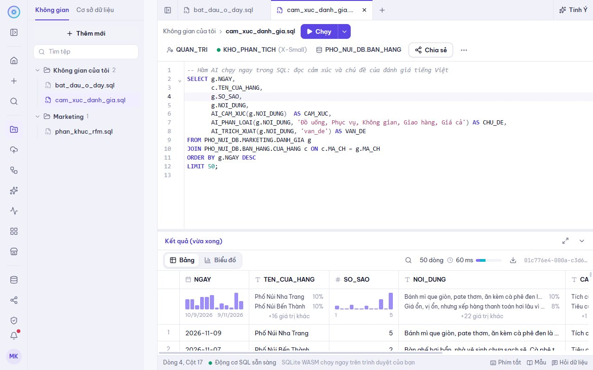 | 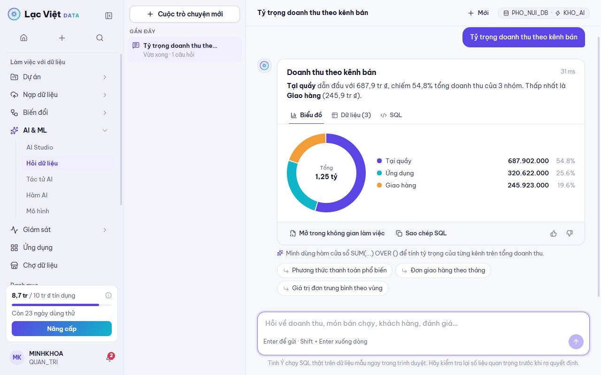 |
| **Ứng dụng dữ liệu chạy trên SQL** | **Trình duyệt dữ liệu** |
| 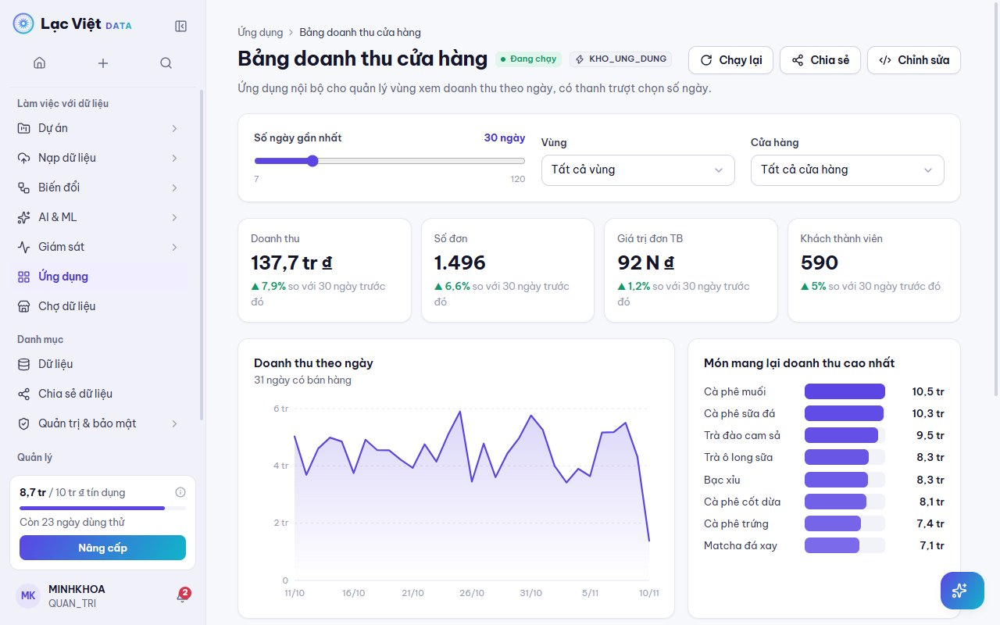 | 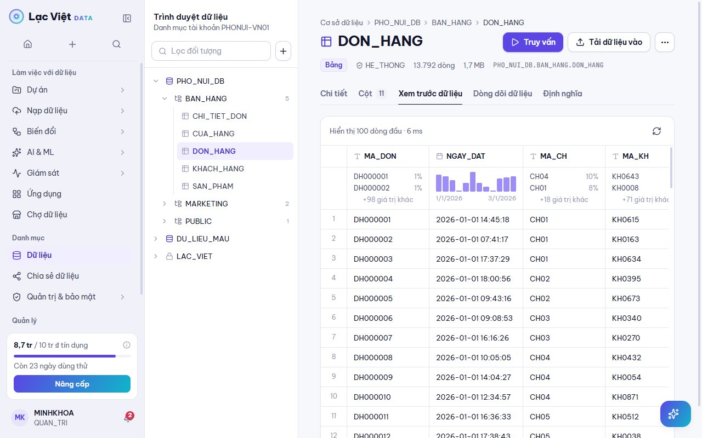 |
| **Tác tử AI** | **Hàm AI tiếng Việt** |
| 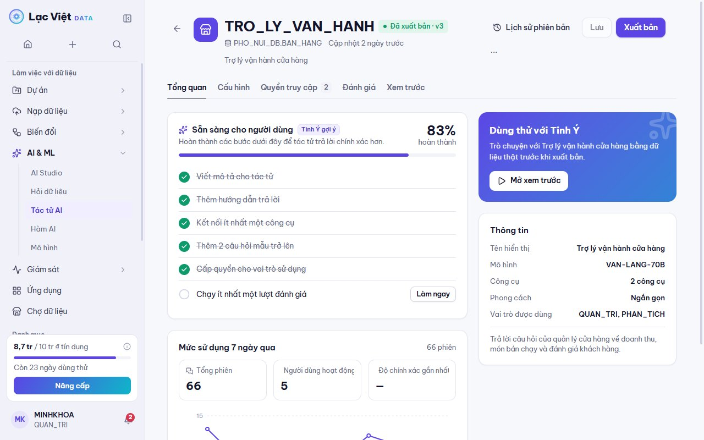 | 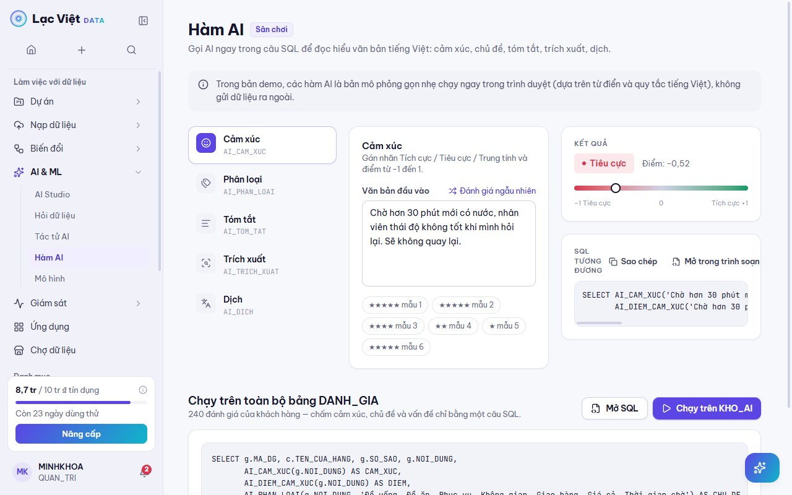 |
| **Lịch sử truy vấn** | **Quản lý chi phí** |
| 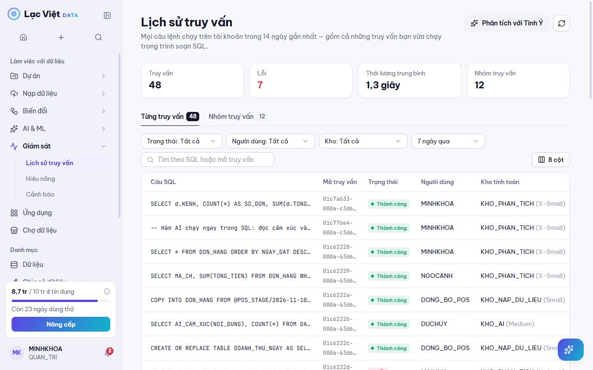 | 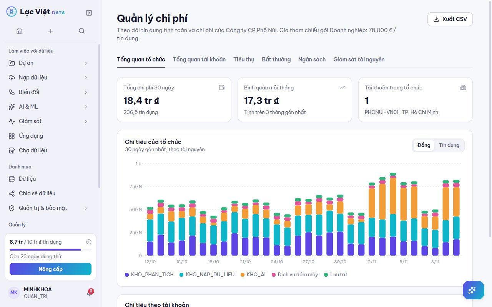 |
| **Chợ dữ liệu** | **Đăng ký dùng thử** |
| 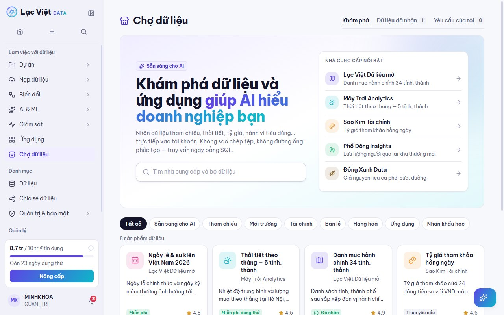 | 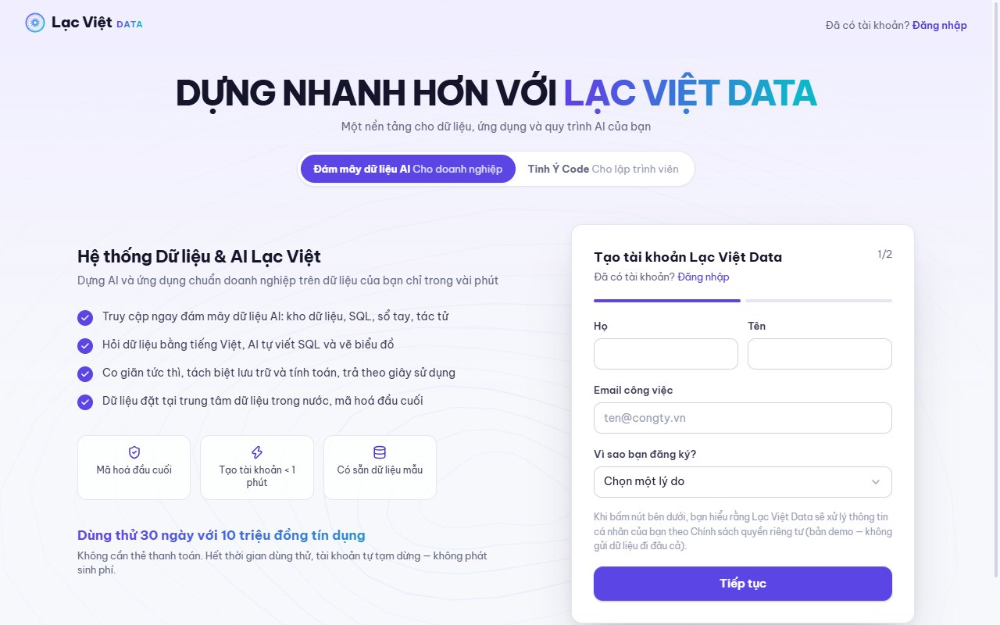 |
| **Giao diện tối** | **Điện thoại** |
| 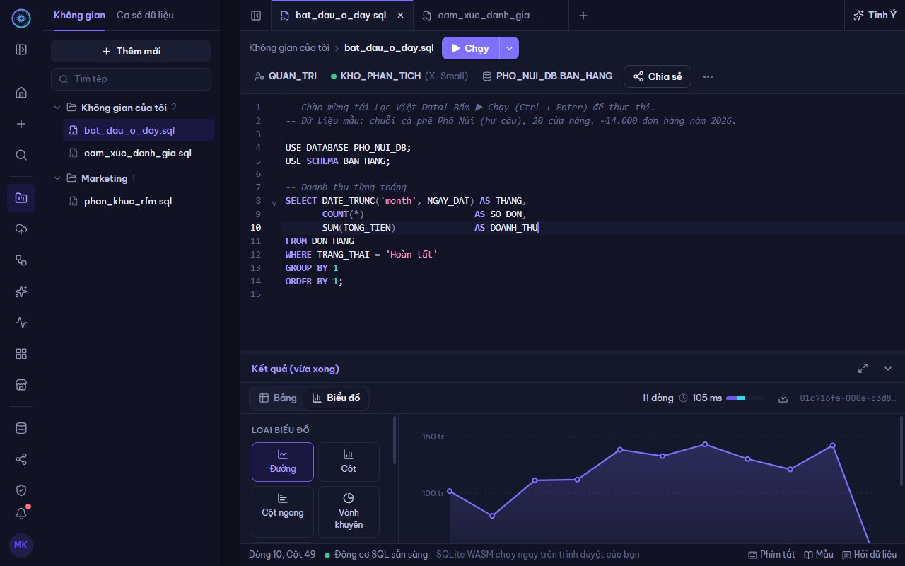 | 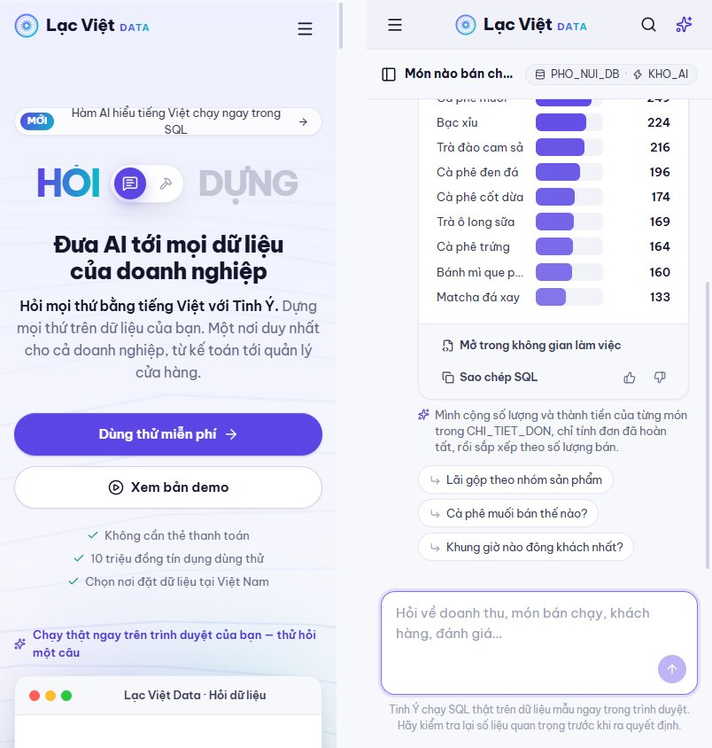 |

## Chạy thử

```bash
npm install
npm run dev        # http://localhost:5195
```

Vào trang **Đăng nhập** rồi bấm **"Vào bằng tài khoản demo"**, hoặc mở thẳng `/trang-chu?demo=1`.

Bản build tĩnh: `npm run build`, kết quả nằm trong `dist`. Khi triển khai lên Vercel không cần chỉnh gì, vì tệp `vercel.json` đã cấu hình điều hướng cho ứng dụng một trang và cho phép nhúng vào ntahientech.com. Vercel chỉ phát các tệp tĩnh; toàn bộ xử lý dữ liệu diễn ra trong trình duyệt người xem.

## Màn hình chính

| Khu vực | Nội dung |
|---|---|
| **Trang giới thiệu** | Hero “HỎI ⇄ DỰNG”, khung demo hỏi dữ liệu chạy thật, tính năng, giải pháp theo ngành, bảng giá có ước tính chi phí, hỏi đáp |
| **Đăng ký / Kích hoạt / Khảo sát / Đăng nhập** | Đăng ký 2 bước (chọn phiên bản, nhà cung cấp đám mây, khu vực), kiểm tra hộp thư, đặt mật khẩu có kiểm tra quy tắc, khảo sát mục đích sử dụng, đăng nhập demo một chạm |
| **Không gian làm việc** | Trình soạn SQL (CodeMirror 6, gợi ý tên bảng/cột), chạy câu lệnh tại con trỏ hoặc tất cả, kết quả nhiều tab, bảng có thống kê cột, biểu đồ tuỳ chỉnh, lịch sử phiên bản có so sánh, chia sẻ, Tinh Ý giải thích / định dạng / sửa lỗi SQL |
| **Hỏi dữ liệu** | Hội thoại tiếng Việt → SQL → biểu đồ + nhận định tự động, lưu lịch sử hội thoại |
| **Tác tử AI** | Cấu hình, hướng dẫn, công cụ, mô hình, quyền truy cập, đánh giá chất lượng, xem trước, xuất bản phiên bản |
| **Dữ liệu** | Cây CSDL › lược đồ › bảng, mô tả do AI tạo, xem trước, dòng dõi dữ liệu, DDL; nạp CSV thành bảng; chợ dữ liệu (cài thật bảng ngày lễ, thời tiết); chia sẻ dữ liệu |
| **Ứng dụng dữ liệu** | Bảng doanh thu cửa hàng, theo dõi đánh giá khách hàng… chạy trên SQL thật, có chế độ xem mã nguồn |
| **Giám sát** | Lịch sử truy vấn (kể cả truy vấn bạn vừa chạy), hồ sơ truy vấn dạng cây, hiệu năng, cảnh báo, tác vụ định kỳ |
| **Quản trị** | Kho & cụm tính toán, người dùng & vai trò, trung tâm bảo mật, chi phí (tiêu thụ, bất thường, ngân sách), tài khoản & thanh toán theo hoá đơn GTGT, cài đặt cá nhân (MFA, mã truy cập) |

Xem thêm [docs/SCREEN_MAP.md](docs/SCREEN_MAP.md) và [docs/DESIGN_SYSTEM.md](docs/DESIGN_SYSTEM.md).

**Phím tắt:** `Ctrl K` tìm mọi thứ · `Ctrl J` hỏi Tinh Ý · `Ctrl Enter` chạy câu lệnh · `Ctrl Shift Enter` chạy tất cả · `Ctrl I` bật/tắt Tinh Ý trong trình soạn.

## Công nghệ

- React 19, Vite 6, Tailwind CSS v4 (token màu bằng biến CSS, có giao diện tối)
- React Router 7 (tải trang theo nhu cầu), Zustand 5 (lưu thao tác vào `localStorage`)
- **sql.js** (SQLite WebAssembly) làm động cơ truy vấn, **CodeMirror 6** làm trình soạn SQL
- Biểu đồ SVG tự viết, không dùng thư viện biểu đồ
- Font Be Vietnam Pro và JetBrains Mono

## Cấu trúc thư mục

```
src
├── engine/          # db.js (SQLite + cú pháp kho dữ liệu), aiFunctions.js, assistant.js (Tinh Ý), seed.js
├── components/
│   ├── ui/          # Button, Input, Modal, Drawer, Popover, Tabs, Badge…
│   ├── charts/      # LineChart, BarChart, HBarChart, Donut, ResultChart
│   ├── data/        # DataGrid (bảng kết quả có thống kê cột), CSV
│   ├── layout/      # AppLayout, Sidebar, CommandPalette, Assistant, Page
│   └── brand/       # Logo (ngôi sao trống đồng)
├── features/        # editor, ai, data, monitor, admin, public
├── pages/           # Mỗi trang một tệp, tải theo nhu cầu
├── data/            # Dữ liệu tham chiếu và dữ liệu nền tảng mô phỏng
├── store/           # Zustand: giao diện, đăng nhập, dữ liệu nền tảng
└── lib/             # Định dạng vi-VN, bộ sinh số ngẫu nhiên có hạt giống
```

---

Thiết kế & phát triển bởi **Ntahien Tech** · [ntahientech.com](https://ntahientech.com)
